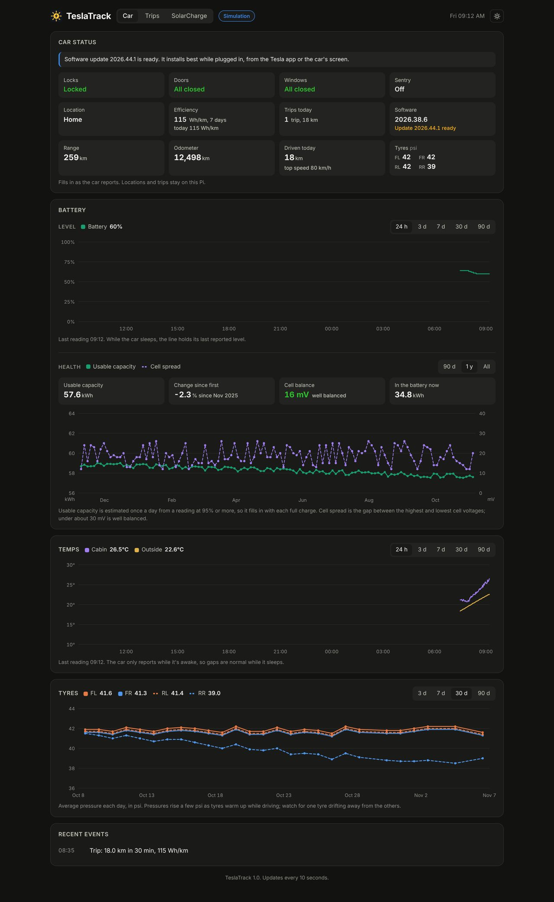

# TeslaTrack

A private logbook and status page for your Tesla, running on a Raspberry Pi at home.

TeslaTrack listens to the car's live data through [Teslemetry](https://teslemetry.com)'s streaming service (no command credits, never wakes the car) and keeps everything on your own Pi: every trip with its route on a map, battery health over the years, tyre pressures, temperatures, and the car's locks, doors and windows.



It's the companion to [SolarCharge](https://github.com/brad-24/solarcharge), which charges the car from surplus solar, but it also runs on its own.

## Features

* **Trips**: every drive logged automatically, with a map of the route, distance, time, energy used, Wh/km, battery used, top and average speed, outside temperature, and where it started and ended (Home, or the suburb). Totals for 7 days, 30 days, 90 days, a year or all time, and a CSV download. Tap Mark to flag a work trip: work kilometres are totalled for the period and each day, and the CSV has a work column for your logbook
* **Car status**: locks, doors, windows, Sentry, home or away, range, odometer, distance and top speed today, software version, with notices like a window left open when rain is forecast, or the car unlocked at home overnight
* **Battery**: level over the last day to 90 days, and battery health: usable capacity logged from each charge to 95% or more, and how well balanced the cells are, charted over months and years
* **Temperatures**: cabin and outside, so you can see how hot the car gets parked in the sun
* **Tyres**: every reading over 3 or 7 days, or each tyre's daily average over 30 or 90 days, so a slow leak stands out
* **Charging away from home**: fast charger and public AC sessions with an estimated cost
* **Private**: locations, routes and trips never leave the Pi. Python standard library only, nothing to install

## What you need

* A Tesla and a [Teslemetry](https://teslemetry.com) account (the low cost Access plan is enough)
* A Raspberry Pi or any Linux machine with Python 3.7 or later, on your home network

## Install

On the Pi:

```
cd ~
git clone https://github.com/brad-24/teslatrack.git
cd teslatrack
cp config.example.ini config.ini
nano config.ini
```

Set `[tesla] vin`, and save your Teslemetry token to the file named in `token_file`, readable only by you:

```
nano ~/.solarcharge_token
chmod 600 ~/.solarcharge_token
```

(SolarCharge users already have this file, and TeslaTrack shares it.)

Try it with made up data first:

```
python3 ~/teslatrack/teslatrack.py --simulate --speed 30
```

Then run it as a service:

```
sudo cp ~/teslatrack/teslatrack.service /etc/systemd/system/
sudo systemctl daemon-reload
sudo systemctl enable --now teslatrack
```

The dashboard is at `http://<pi address>:8084`.

## Teslemetry fields

In the Teslemetry console, under Telemetry Configuration, turn on the fields for what you want. Fields not marked Free may need a higher Teslemetry plan.

| For | Fields |
|---|---|
| Trips | Gear, Location, Odometer, VehicleSpeed, EnergyRemaining, BatteryLevel, OutsideTemp |
| Battery | BatteryLevel, ChargeLimitSoc, TimeToFullCharge, EnergyRemaining, BrickVoltageMax, BrickVoltageMin |
| Temps | InsideTemp, OutsideTemp |
| Tyres | TpmsPressureFl, TpmsPressureFr, TpmsPressureRl, TpmsPressureRr |
| Car status | Locked, DoorState, FdWindow, FpWindow, RdWindow, RpWindow, SentryMode, RatedRange, Version, SoftwareUpdateVersion |
| Away charging | FastChargerPresent, DCChargingEnergyIn, ACChargingEnergyIn |

For smoother route lines, give Location a short interval (10 to 30 seconds) in the same screen.

## Home

TeslaTrack works out "home" by itself: from where the car is plugged into the Wall Charger, when SolarCharge runs on the same Pi, or otherwise from where the car spends three nights. You can also set it under `[home]` in config.ini.

## With SolarCharge

If SolarCharge runs on the same Pi:

* TeslaTrack uses SolarCharge's rain forecast in the car notices
* SolarCharge can take the car's battery level, charge limit and time to full from TeslaTrack (`stream = teslatrack` under `[tesla]` in SolarCharge's config.ini), so only one app holds the Teslemetry stream
* SolarCharge's Full charge card learns which days the car is usually home

## Privacy

Trips, routes and locations are stored only in `~/teslatrack/data` on the Pi. Suburb names are looked up from OpenStreetMap's Nominatim service, one request per trip end, sending only that point; turn this off with `place_names = false`. The map tiles come from OpenStreetMap when you view a trip.

The dashboard has **no login**. Never open port 8084 on your router; use a private network such as [Tailscale](https://tailscale.com) to see it away from home.

## Files

| Where | What |
|---|---|
| `teslatrack.py` | the program |
| `car.html`, `trips.html` | the pages |
| `vendor/leaflet/` | the map library ([Leaflet](https://leafletjs.com), BSD 2 clause licence) |
| `data/trips.json`, `data/routes/` | your trips and their routes |
| `data/state.json` | car history, battery health, tyres (saved every 30 minutes) |
| `data/archive/daily.csv` | one row a day: distance, trips, energy, Wh/km, top speed, battery health, tyres |

## Disclaimer

A hobby project, not affiliated with or endorsed by Tesla or Teslemetry. Provided as is, without warranty.

## Licence

[MIT](LICENSE). Map data © OpenStreetMap contributors. Leaflet © Volodymyr Agafonkin and contributors.
